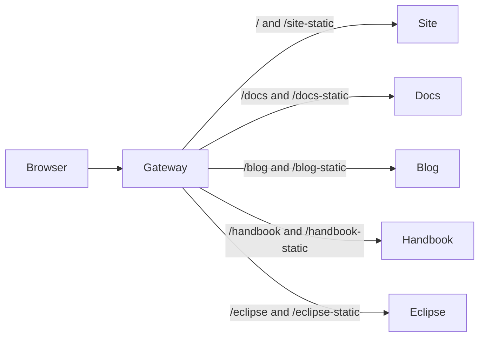

# Prisma Web on Composer

One Composer application runs all five websites as separate Compute services,
with a sixth service providing their shared HTTP entrypoint. Blog media
stays in the blog's original public directory. This is an
additional deployment path: the existing Vercel configs, app build commands,
and deployment workflows are retained.



## Local development

Use Node 22.18+, 24.11+, or 26+, and the repository's pnpm version:

```sh
pnpm install --frozen-lockfile
pnpm dev
```

`pnpm dev` builds the websites sequentially, bundles the gateway with the pinned
Bun dependency, checks artifact sizes, and runs `prisma dev module.ts`. Open the
**gateway URL printed by Composer**. Ports are assigned by the emulator; they
are not the old Turbo ports. The gateway serves all five paths in the diagram.

The first build and first local provisioning take longer than a warm start.
The build also requires `tar` (provided by macOS and the Ubuntu CI runner) to
measure compressed upload sizes without buffering archives in memory.
The compute emulator is isolated under `.prisma-composer/emulators` in this
checkout, so it does not inherit another checkout's services or an older Bun
from a machine-wide daemon. An explicitly set
`PRISMA_COMPOSER_EMULATORS_DIR` overrides that location.

For subsequent runs and edits:

```sh
pnpm composer:dev       # run existing built output
pnpm composer:build     # rebuild in another terminal
pnpm composer:check     # typecheck declarations and run gateway/config tests
pnpm composer:smoke     # start, exercise, and stop the complete local stack
```

Composer runs production builds; it does not provide Next.js source HMR.
Website watches use `.next/BUILD_ID` so services restart after a complete build,
without watching every traced dependency. The gateway watches its built directory.
If changing declarations, `prisma.config.ts`, or runtime bindings, restart dev.
To keep the original Next.js HMR workflow, use `pnpm dev:turbo` or an individual
app's `dev` script.

`pnpm composer:smoke <gateway-url>` checks an already-running stack. Initial
landing pages get up to two minutes for Compute routing/startup to settle;
subsequent article and asset checks retain strict status assertions. Full media
downloads have a two-minute client deadline. The CI workflow builds and runs
the local smoke test without cloud credentials.

## Resource limits

The design assumes **1 GB memory and 1 GB files per Compute service**. Each
assembled artifact must be below **900,000,000 bytes**, leaving room for runtime
files and packaging overhead. The check counts the native Next.js assembler's
output, including public assets and repaired pnpm dependencies, and also runs
during `dev` and `deploy` assembly.

Local measurements on 2026-10-16 with all six services in the `web` module:

| Service | Assembled files, MB | Compressed estimate, MB | RSS after smoke, MB |
| --- | ---: | ---: | ---: |
| Site | 265.9 | 153.2 | 132.6 |
| Docs | 426.1 | 227.8 | 417.9 |
| Blog | 848.0 | 685.1 | 242.0 |
| Handbook | 45.0 | 15.1 | 103.6 |
| Eclipse | 82.6 | 18.9 | 129.4 |
| Gateway | 1.3 | 0.3 | 141.4 |

The smoke runner also checks each Bun process against a 900 MB RSS budget after
loading website pages and current/legacy docs articles. These macOS samples are
not a sustained-load or production-concurrency guarantee.

Alchemy's deployment uploader has a **768 MiB (805,306,368 byte)** ceiling with
[upstream PR #2257](https://github.com/alchemy-run/alchemy/pull/2257). Its npm
release still has the old 256 MiB cap, so a tracked pnpm patch backports that
change to `alchemy@2.0.0-beta.83`. Both Node's compiled entry and Bun's source
entry are patched; upload timeouts increase from five to fifteen minutes.
See [patch provenance and removal instructions](patches/README.md). The upstream
preview download expires, so it is not a deployment dependency.

Compressed archives are checked against **750,000,000 bytes** to reserve room
for bootstrap files and tar encoder differences. The separate expanded budget
remains **900,000,000 bytes** under Compute's 1 GB filesystem limit. Both checks
run during build, local dev and cloud assembly.

The blog now includes all 1,470 original public files (650.8 MiB of content)
in its own Next.js service. There are no media shard services or runtime media
catalog. Next handles their existing URLs, redirects, headers, streaming, byte
ranges, HEAD, ETags and cache validation. The smoke covers representative file
types and the largest file, comparing original bytes by hash.

Alchemy's generic `createComputeArchive()` helper also caps *expanded* input at
768 MiB. Composer uses its own packager and passes the compressed file to
Alchemy's `Deployment` uploader, so that helper is not on this application's
path. The complete blog can therefore exceed 768 MiB expanded while satisfying
Compute's 1 GB limit and the uploader's compressed cap. If media growth exceeds
either repository budget, move it to object storage or split services again.

`COMPOSER_BUILD=1` enables standalone output with the monorepo tracing root.
In that mode, docs and blog use lazy MDX collections and omit the article
`generateStaticParams` function. Articles render on each request, avoiding both
the initial HTML/RSC footprint and an ISR cache that would grow as readers visit
more pages. Their other static routes, including Markdown feeds, remain built.
Source maps are omitted from Composer artifacts; build-time Sentry uploads can
still use the original build output. Eclipse changes from static export to a
standalone server mounted at `/eclipse` only in Composer mode.

Without `COMPOSER_BUILD`, Vercel retains eager MDX collections, article
prerendering, Eclipse static export, and the site's existing zone rewrites.
The Turbo tasks distinguish the two build modes and include the shared Next
config in cache inputs. Both modes write `.next`; stop Composer before running
a Vercel-mode build locally, then rebuild Composer before starting it again.

## Routing and configuration

`module.ts` names the application `web`, matching the existing Console project,
and connects the gateway to the five websites through
declared HTTP ports. Each upstream exposes `rawHttpContract`; the gateway declares
five `rawHttp()` dependencies and reads their resolved URLs through `service.load()`.
The topology therefore contains five communication connections and Console infers
only `gateway` as the Internet entrypoint. This describes the intended traffic
flow; service URLs remain directly reachable.

Composer is pinned to `0.30.0-dev.9`, the published build containing
[HTTP ports](https://github.com/prisma/composer/pull/358). Stable `0.30.0`
predates that merge. The pnpm override pins Prisma's Composer CLI to the same
build; the selected Prisma CLI remains `8.0.0-rc.22` and shares its required
CLI engine version. Replace these three Composer pins together when a stable
release includes the API.

`serviceOrigin("gateway")` remains a configuration value for each website's
cross-site links and search origin. It is not an additional dependency edge.
The GitHub environment URL and deployed smoke test explicitly select the gateway
from the service URL map, independently of provisioning order.

The gateway normalizes repeated slashes and applies site `vercel.json`
redirects first. Matching site Next.js redirects and external `beforeFiles`
rewrites from the built routes manifest go to the site server before zone
dispatch. This preserves hostname rules such as
`accelerate-speed-test.prisma.io` and Next's own redirect response behavior.
Docs `vercel.json` redirects apply once the docs zone is selected. Next.js
handles each zone's own routes, redirects, MCP forwarding,
analytics/dataguide fallbacks, content negotiation, and response headers.
Vercel dashboard domain redirects, firewall rules, and CDN settings are outside
the repository; they must be audited separately before moving production traffic.
The gateway uses the vendored Apache-2.0 [`@prisma/proxy`](packages/proxy/README.md)
library. The build copies the original Vercel configs and site Next manifest
alongside the server. The small runtime entrypoint points the library at those
files, compiles the routing tables in memory once at boot, and binds upstreams
from Composer HTTP dependencies. There is no generated routing-plan artifact. Restart after
changing config files; requests reuse the startup snapshot. The library's provider adapter contract also
supports adding Netlify and other formats without changing the HTTP runtime.
The optional Agent Front bridge preserves the site's global middleware on
child-site requests without reporting root requests twice. When enabling it,
bind the same ORA settings to the site input and the gateway's `agentFront` input.
Asset prefixes are translated to the standalone server's `_next` path, with
the zone's base path preserved. Requests keep their method, body, query,
cookies, RSC headers, range semantics, and public forwarded origin. Responses
keep redirects, cookies, compression, and streaming.

The small build extension wraps Composer's native Next.js assembler. Its
bootstrap resolves typed service input and writes the existing apps' legacy
environment names before Next.js starts. This preserves their Vercel code path
and binds Next's `HOSTNAME` to `0.0.0.0`.

Compute ingress selects a service from HTTP `Host`, so the proxy sends the
upstream hostname at that boundary. An authenticated internal hop preserves the
public host and scheme for Next's hostname rules, redirects and server actions.
The website bootstrap restores those fields before Next handles the request,
then removes the private markers from both header representations. Forged or
malformed markers do not change the host. The proxy sends this credential only
to the five named website services, never to other origins or external rewrites.

Pages and assets need no user-supplied credentials. Optional external integrations are bound
only when selected with `COMPOSER_INTEGRATIONS`, a comma-separated list:

| Integration | Websites | Required platform secrets |
| --- | --- | --- |
| `mixedbread` | Site, docs, blog | `MIXEDBREAD_API_KEY` |
| `brevo` | Site, docs, blog | `BREVO_API_KEY` |
| `extensions` | Site | `GITHUB_EXTENSIONS_TOKEN` |
| `linear` | Docs | `GITHUB_WEBHOOK_SECRET`, `BOT_TOKEN_GITHUB_PR_LINEAR_WEBHOOK`, `LINEAR_API_KEY` |

For local development, copy `.env.example` to `.env`, set e.g.
`COMPOSER_INTEGRATIONS=mixedbread,brevo`, and supply the corresponding keys.
The build and Prisma config load this root file without overwriting exported
shell variables. Enabled, unset secrets receive Composer's local placeholders,
so external integration calls require real values.

`composer/integrations.ts` binds only enabled credentials used by each website.
Deploy preflight requires every bound `envSecret`, even for optional input
fields. The default empty selection lets a new project deploy before credentials
are configured. Enabling an integration requires its real secrets in the target
project's Preview or Production environment; no cloud placeholders are created.
Optional input fields cover extension repository settings, the Linear team, canonical
URL, and Agent Front settings. Add explicit `envParam`/`envSecret` bindings for
the integrations you want when configuring the production workspace. Optional
Agent Front credentials are not bound by default. `NEXT_PUBLIC_*` values,
including analytics configuration, must be supplied **at build time**; a
runtime secret binding cannot rewrite browser bundles or prerendered metadata.

## GitHub deployment

The branch preview is live at
[the shared gateway](https://dwgv6bi6aljw05msqzcpvtgg.ewr.prisma.build).
Current build, deployment and smoke evidence is linked in
[PR #8458](https://github.com/prisma/web/pull/8458); the findings guide records
the measurements and the earlier ten-service deployment history.

The repository is already connected to the Prisma project **web**. Keep that
connection; the root module's name must match the project name.

`.github/workflows/prisma-deploy.yml` runs `prisma/cloud-deploy-action@v1` with
GitHub OIDC (`id-token: write`). It installs the pinned pnpm dependencies, builds
with `pnpm composer:build`, and deploys `module.ts`. Node 24 and Bun 1.4.3 are
provided by the workflow. No service-token secret is needed for the connected
repository. The normal `pnpm build` command and Vercel deployments keep their
existing behavior.

The workflow generates a masked, random internal `WEB_PROXY_KEY` before deploy.
Composer provisions it only when the target environment has no stored value;
later deploys reuse that value. Gateway and website inputs bind the same secret.
Local dev uses Composer's shared local placeholder for this internal key. A first
manual cloud deploy outside the workflow needs a random `WEB_PROXY_KEY` exported
in its shell; subsequent deploys can use the stored platform value.

The workflow reads the non-secret GitHub variable `COMPOSER_INTEGRATIONS`.
Leave it unset for the initial preview. To enable integrations, first add their
secrets in Prisma Console under the project's appropriate Preview/Production
scope, then set the variable on the matching GitHub environment. The production
environment is `prisma-production`; branch previews use
`prisma-preview/<branch-name>`. A repository-level variable applies to both, so
all selected secrets must exist in both scopes when using that option.

Pushes to the default branch deploy to production; pushes to other branches
deploy their branch preview. Tags do not trigger this workflow. The deployment
workflow also skips changes limited to these two operational Composer guides;
website content changes still deploy. The deployment button points explicitly
at the gateway, and a post-deploy smoke test exercises
all five websites through that URL. Manual runs use the same branch policy.
Preview cleanup is handled by the connected repository's platform automation;
the workflow does not use the deploy action's currently unsupported destroy mode.

While this setup remains in PR #8458, push that branch to test a preview.
Console's **Check again** inspects the default branch: its automatic Next.js
setup currently mistakes the shared UI package for an app with no build script.
The explicit Composer module and workflow provide this monorepo's deployment
path once merged. See the [deploy action reference](https://github.com/prisma/cloud-deploy-action#readme).

## Production workspace follow-up

Merging the workflow to the default branch triggers a production deployment
to the already-connected project. Before merging, validate this branch's
preview, confirm the project's region and runtime, and configure the integration
and public build settings needed in production. Domain configuration and moving
live traffic to the gateway remain separate follow-up steps; this PR preserves
the existing Vercel deployment path.

The separate Composer CI job still performs local validation without cloud
credentials. See [Composer porting](https://www.prisma.io/docs/composer/porting-an-app)
and [deploy on push](https://www.prisma.io/docs/compute/deploy-on-push).

Detailed observations and product improvement suggestions are recorded in
[COMPOSER_FINDINGS.md](COMPOSER_FINDINGS.md).
