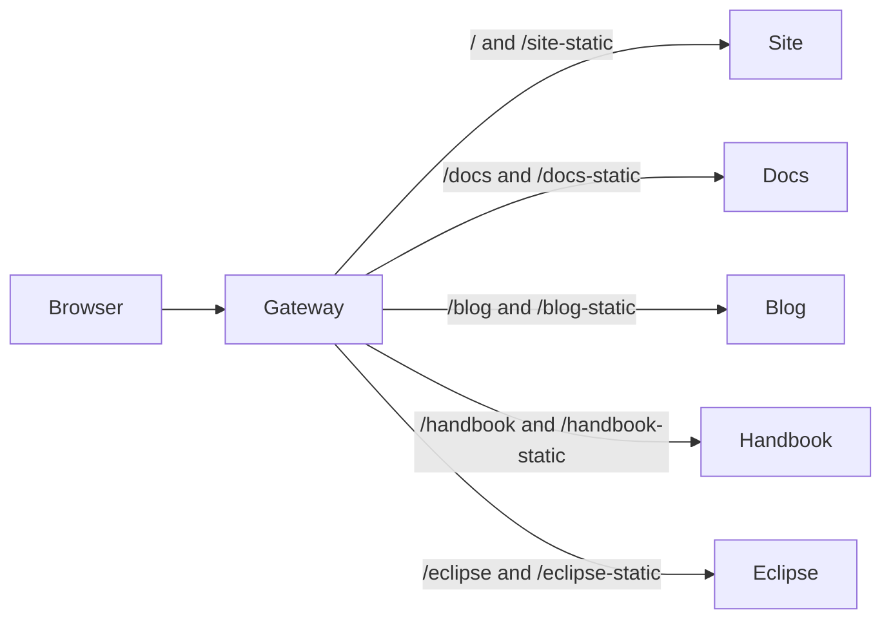

# Prisma Web on Composer

One Composer application runs all five websites as separate Compute services,
with a sixth service providing their shared HTTP entrypoint. This is an
additional deployment path: the existing Vercel configs, app build commands,
and deployment workflows are retained.



## Local development

Use Node 22.18+, 24.11+, or 26+, and the repository's pnpm version:

```sh
pnpm install --frozen-lockfile
pnpm dev
```

`pnpm dev` builds the websites sequentially, bundles the gateway with the pinned
Bun dependency, checks artifact sizes, and runs `prisma dev module.ts`. Open the
**gateway URL printed by Composer**. Ports are assigned by the emulator; they
are not the old Turbo ports. The gateway serves all five paths in the diagram.

The first build and first local provisioning take longer than a warm start.
The compute emulator is isolated under `.prisma-composer/emulators` in this
checkout, so it does not inherit another checkout's services or an older Bun
from a machine-wide daemon. An explicitly set
`PRISMA_COMPOSER_EMULATORS_DIR` overrides that location.

For subsequent runs and edits:

```sh
pnpm composer:dev       # run existing built output
pnpm composer:build     # rebuild in another terminal
pnpm composer:check     # typecheck declarations and run gateway/config tests
pnpm composer:smoke     # start, exercise, and stop the complete local stack
```

Composer runs production builds; it does not provide Next.js source HMR.
Website watches use `.next/BUILD_ID` so services restart after a complete build,
without watching every traced dependency. The gateway watches its built directory.
If changing declarations, `prisma.config.ts`, or runtime bindings, restart dev.
To keep the original Next.js HMR workflow, use `pnpm dev:turbo` or an individual
app's `dev` script.

`pnpm composer:smoke <gateway-url>` checks an already-running stack. The CI
workflow builds and runs the full smoke test without cloud credentials.

## Resource limits

The design assumes **1 GB memory and 1 GB files per Compute service**. Each
assembled artifact must be below **900,000,000 bytes**, leaving room for runtime
files and packaging overhead. The check counts the native Next.js assembler's
output, including public assets and repaired pnpm dependencies, and also runs
during `dev` and `deploy` assembly.

Measurements from this port, before later repository changes:

| Service | Assembled files, decimal MB | RSS after smoke requests, decimal MB |
| --- | ---: | ---: |
| Site | 264 | 129 |
| Docs | 426 | 467 |
| Blog | 846 | 211 |
| Handbook | 45 | 115 |
| Eclipse | 83 | 128 |
| Gateway | 1 | 105 |

The smoke runner also checks each Bun process against a 900 MB RSS budget after
loading website pages and current/legacy docs articles. These macOS samples are
not a sustained-load or production-concurrency guarantee.

Blog public media accounts for approximately 653 MiB on disk and is the largest
remaining constraint. The gateway streams bodies rather than buffering media.
If the blog exceeds the budget, offload public media to object storage or a
dedicated asset service before deploying. A compressed archive fitting the
limit is insufficient; the check uses the expanded files.

`COMPOSER_BUILD=1` enables standalone output with the monorepo tracing root.
In that mode, docs and blog use lazy MDX collections and omit the article
`generateStaticParams` function. Articles render on each request, avoiding both
the initial HTML/RSC footprint and an ISR cache that would grow as readers visit
more pages. Their other static routes, including Markdown feeds, remain built.
Source maps are omitted from Composer artifacts; build-time Sentry uploads can
still use the original build output. Eclipse changes from static export to a
standalone server mounted at `/eclipse` only in Composer mode.

Without `COMPOSER_BUILD`, Vercel retains eager MDX collections, article
prerendering, Eclipse static export, and the site's existing zone rewrites.
The Turbo tasks distinguish the two build modes and include the shared Next
config in cache inputs. Both modes write `.next`; stop Composer before running
a Vercel-mode build locally, then rebuild Composer before starting it again.

## Routing and configuration

`module.ts` provisions the six services. `serviceOrigin()` binds the gateway's
upstreams and each website's search origin to the current environment, so
deployed URLs are not compiled into cross-zone rewrites.

The gateway normalizes repeated slashes and applies site `vercel.json`
redirects first. Matching site Next.js redirects and external `beforeFiles`
rewrites from the built routes manifest go to the site server before zone
dispatch. This preserves hostname rules such as
`accelerate-speed-test.prisma.io` and Next's own redirect response behavior.
Docs `vercel.json` redirects apply once the docs zone is selected. Next.js
handles each zone's own routes, redirects, MCP forwarding,
analytics/dataguide fallbacks, content negotiation, and response headers.
Vercel dashboard domain redirects, firewall rules, and CDN settings are outside
the repository; they must be audited separately before moving production traffic.
The optional site Agent Front integration needs a separate production decision:
direct docs/blog dispatch bypasses the site's global Agent Front middleware.
Binding its credentials only to the site would cover marketing pages, whereas
Vercel's site-to-zone rewrites currently let it observe docs/blog requests too.
Asset prefixes are translated to the standalone server's `_next` path, with
the zone's base path preserved. Requests keep their method, body, query,
cookies, RSC headers, range semantics, and public forwarded origin. Responses
keep redirects, cookies, compression, and streaming.

The small build extension wraps Composer's native Next.js assembler. Its
bootstrap resolves typed service input and writes the existing apps' legacy
environment names before Next.js starts. This preserves their Vercel code path
and binds Next's `HOSTNAME` to `0.0.0.0`.

Pages and assets need no credentials. To exercise integrations, copy
`.env.example` to `.env` and supply the relevant keys; the build and Prisma
config load this root file without overwriting exported shell variables.
Unset secrets receive Composer's local placeholders, so calls to those external
integrations will not succeed without real values.

`composer/website.ts` binds only the credentials used by each website. Optional
input fields cover extension repository settings, the Linear team, canonical
URL, and Agent Front settings. Add explicit `envParam`/`envSecret` bindings for
the integrations you want when configuring the production workspace. Optional
Agent Front credentials are not bound by default. `NEXT_PUBLIC_*` values,
including analytics configuration, must be supplied **at build time**; a
runtime secret binding cannot rewrite browser bundles or prerendered metadata.

## Production workspace follow-up

This PR does not provision or deploy production resources or replace Vercel.
Before the first production deploy, choose the workspace and region, confirm
the Compute runtime is compatible with Next.js 16.3, configure the required
integration and public build settings, build, and smoke-test again. Then deploy
`module.ts` to a preview stage, test its gateway, and configure the public domain
on the gateway. No domains or live traffic need to change during that validation.

Future deployment automation should use the connected GitHub repository and
Prisma's OIDC deploy action. The new Composer CI job performs local validation
only. See [Composer porting](https://www.prisma.io/docs/composer/porting-an-app)
and [deploy on push](https://www.prisma.io/docs/compute/deploy-on-push).

Detailed observations and product improvement suggestions are recorded in
[COMPOSER_FINDINGS.md](COMPOSER_FINDINGS.md).
