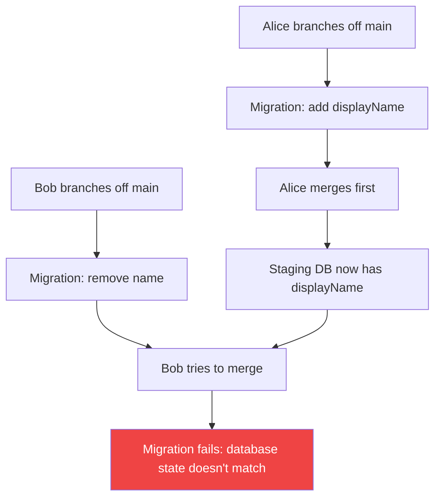
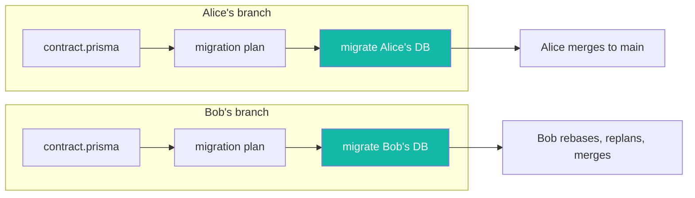
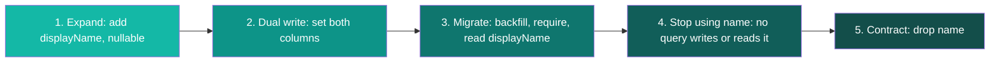

import {
  deployTerminalLines,
  expandContractBefore,
  expandContractAfter,
  expandTerminalLines,
  contractContractBefore,
  contractContractAfter,
  contractTerminalLines,
} from "./snippets";

**Give every feature branch its own database, and risky schema changes become routine.** With [deploy on push](https://www.prisma.io/docs/compute/deploy-on-push), every pushed branch other than the default one gets a [Prisma Compute](https://www.prisma.io/docs/compute) preview with its own services and, for databases declared in the Composer module, its own new [Prisma Postgres](https://www.prisma.io/docs/postgres) database; production data is not copied, and a push to the default branch deploys production. Migrations from different pull requests stop colliding, and a destructive change gets a full rehearsal of its migration sequence on real infrastructure before it touches production.

This post walks through the workflow: why a shared staging database breaks under concurrent schema changes, how a database per preview removes the conflict, and how to rehearse a destructive change end-to-end with the expand-and-contract pattern.

:::note

Three Prisma products appear here, each with one job:

- **Prisma Compute** hosts your app, which you declare as a [Prisma Composer](https://www.prisma.io/docs/composer) module, and deploys a preview for each pushed branch other than the default one. It provides the isolation. Its commands are part of the unified Prisma CLI that ships with Prisma 8: `npx prisma deploy`, which the [deploy-on-push](https://www.prisma.io/docs/compute/deploy-on-push) GitHub Action runs for you.
- **Prisma Postgres** is the database each preview gets: a new one for each database the module declares.
- **[Prisma 8](https://www.prisma.io/docs/orm)** provides the migration toolchain in the examples, through the same CLI (`npx prisma`). For a database declared with `postgres()`, the deploy applies those migrations itself. Your app can query its database with any PostgreSQL client, but deploying needs this CLI; the FAQ covers Prisma 7.

:::

## Why a shared staging database breaks

A shared staging database has one state. Concurrent branches need different ones. When two developers change the schema in the same sprint, they collide:

1. Alice branches off `main`, adds a `displayName` column, and migrates the shared staging database.
2. Bob branches off `main`, removes a legacy `name` column, and migrates the same database.
3. Alice merges first. Her migration becomes the new baseline on `main`.
4. Bob tries to merge. The staging database now reflects Alice's schema, not the one his migration was written against. His migration fails, or worse, half-applies.



[Prisma 8 migrations](https://pris.ly/ts-migrations-pn) make this failure precise instead of silent: every migration records the contract state it starts `from` and the state it moves `to`, and the runner refuses to apply a migration against a database in the wrong state. Bob gets a hard error instead of a corrupted staging environment.

The conventional workarounds all paper over the same root cause:

- **Rebase and replan**: Bob replans his migration against Alice's baseline and hopes it still does what he intended. Works for additive changes, gets fragile with data transformations.
- **Reset staging on every merge**: re-apply every migration from scratch. Technically sound, but it destroys the data your integration tests rely on.
- **Sequential merges**: only one person touches the schema at a time. The de facto standard, and the slowest option.

The root cause is one database serving multiple migration timelines, so the fix is one database per timeline.

## One database per preview

On Prisma Compute, a preview is a real resource in your project, a preview branch with its own services and, for each database your Composer module declares, its own new database. Deploy a stage name that doesn't exist yet and Compute provisions an isolated environment for it:

<AgentPrompt
  prompt="Deploy this branch to Prisma Compute as a preview."
  skill="prisma-compute"
  terminalCommand="npx prisma deploy module.ts --stage remove-legacy-name"
  terminalLines={deployTerminalLines}
/>

With deploy on push set up, you don't run that command yourself: a push to the `remove-legacy-name` branch runs the same deploy in GitHub Actions, with the stage named after the branch. For a database declared with `postgres()`, the deploy applies your committed `migrations/` before the service starts, so the preview database starts with your schema and no rows. A `rawPostgres()` database starts empty and is yours to migrate.

Alice's preview gets a database with her schema. Bob's preview gets a database with his. Neither can break the other, and neither needs to rebase until merge time. When Bob does rebase after Alice merges, he replans against the updated contract and tests the result on his own preview database first.



Isolation solves the concurrency problem. It also gives you a safe place to rehearse changes that are dangerous by nature: expand-and-contract migrations.

## Rehearse the risky change: expand and contract

Renaming a column, changing a type, dropping a field that production code still reads: one big migration for any of these breaks whatever is running while it applies. The safe version splits the change into five small, individually harmless steps, three of them migrations:

1. **Expand**: add the new schema next to the old. Both code paths work.
2. **Dual write**: deploy app code that writes both the old and the new schema.
3. **Migrate**: once no running version writes only the old schema, backfill data from old to new, inside a migration, and switch reads to the new schema in the same deploy.
4. **Stop using the old schema**: deploy app code whose queries neither write nor read the old schema.
5. **Contract**: remove the old schema once no running version reads or writes it.

The pattern is well known and rarely practiced, because rehearsing a three-migration sequence on a shared database is exactly the kind of multi-deploy work that collides with everyone else. On a preview database, you run the whole cycle in isolation, verify each step, and only then promote it to production, one step per deploy and in the same order. With deploy on push, that means merging each step to the default branch on its own, as one pull request per step or the branch merged commit by commit, and letting its production deploy finish before you merge the next.

Here's the cycle for replacing a legacy `name` column with `displayName`: the same two columns from the Alice and Bob story, now done properly as one deliberate sequence on one branch. Steps 1, 3 and 5 each edit `contract.prisma`, run `npx prisma contract emit` to regenerate `contract.json`, and plan a migration; steps 2 and 4 change only app code. Plans start from the `db` ref, which a Composer deploy doesn't move, so keep it current by applying each migration to your local database with `npx prisma db migrate --advance-ref db`, or pass `--from` with the previous migration's directory to each plan.

### Step 1: Expand

Add `displayName` as nullable, so existing code that only knows about `name` keeps working:

<AgentPrompt
  prompt="Add a displayName column to User without breaking the code that still reads name."
  language="prisma"
  fileName="contract.prisma"
  skill="prisma-8"
  before={expandContractBefore}
  after={expandContractAfter}
  terminalCommand="npx prisma migration plan --name add_display_name"
  terminalLines={expandTerminalLines}
/>

The planner turns the contract diff into a TypeScript migration:

```typescript
// migrations/app/20260724T1000_add_display_name/migration.ts (excerpt)

override get operations() {
  return [
    this.addColumn({
      schema: "public",
      table: "user",
      column: col("displayName", "text", { codecRef: { codecId: "pg/text@1" } }),
    }),
  ];
}
```

Commit it and push the branch: the deploy applies it to the preview database before the service starts. Old code still reads and writes only `name`, and keeps working because `displayName` is nullable.

### Step 2: Dual write

Before any migration requires `displayName`, every running version of the app has to write it. Deploy app code that sets both columns on every insert and update. `name` is still required, and rows written before this deploy have no `displayName` until the backfill runs, so this version keeps reading `name`. Keep writing both columns until step 4, because until then some running version still reads `name`:

```typescript
// Until step 4, every write sets both columns
await db.orm.public.User.create({ email, name, displayName: name });

await db.orm.public.User.where({ id }).update({ name: newName, displayName: newName });
```

This step has no migration. Push it to the preview and check that new rows get both columns.

### Step 3: Migrate

Start this step only once no running version writes `name` alone. The backfill below fills the rows that exist when it runs; after that, `NOT NULL` rejects any insert that leaves `displayName` out, so an instance still running code from before step 2 would start failing. In production, ship this migration only after the step 2 deploy has replaced every instance of the previous version.

Make `displayName` required in the contract, and `name` optional, so that step 4 can stop writing it:

```prisma
// contract.prisma
model User {
  id          Int     @id @default(autoincrement())
  email       String  @unique
  displayName String  // was String?
  name        String? // was String; dropped in step 5

  @@map("user")
}
```

```bash
npx prisma migration plan --name require_display_name --backfill User.displayName
```

Without a flag, the planner tightens the column directly, and the apply fails while any row holds `NULL`. Only you know what existing rows should contain, so `--backfill User.displayName` has it scaffold a backfill placeholder in front of the constraint and leave the query to you. The backfill lives [inside the migration](https://pris.ly/data-migrations-pn) as a `dataTransform`, written with the same type-safe query builder you use in your app, instead of a standalone script that runs outside your migration history. Filled in:

```typescript
// migrations/app/20260724T1100_require_display_name/migration.ts (excerpt)

override get operations() {
  return [
    this.dataTransform(endContract, "backfill-user-displayName", {
      check: () =>
        db.public.user
          .select("id")
          .where((f, fns) =>
            fns.or(fns.eq(f.displayName, null), fns.ne(f.displayName, f.name)),
          )
          .limit(1),
      run: () =>
        db.public.user
          .update((f, fns) => ({
            displayName: fns.raw`COALESCE(${f.name}, 'Anonymous')`.returns("pg/text@1"),
          }))
          .where((f, fns) =>
            fns.or(fns.eq(f.displayName, null), fns.ne(f.displayName, f.name)),
          ),
    }),
    this.setNotNull({ schema: "public", table: "user", column: "displayName" }),
    this.dropNotNull({ schema: "public", table: "user", column: "name" }),
  ];
}
```

`check` asks "are there rows that still need this?" and `run` performs the change, here copying each row's `name` into `displayName`. Both also match rows where the two columns differ: while step 2 rolled out, an instance of the older version could still change `name` on a row that a new instance had already given a `displayName`, and step 2 code always keeps the two equal, so a difference is a stale copy. Each migration imports a snapshot of the contract as it stood at that point in history, saved under `migrations/snapshots/`, and both queries are typed against this migration's snapshot rather than your live schema. That's why the query can reference `name` even though a later migration drops it.

After editing, recompile with `node migration.ts`. The `dataTransform` compiles to the same `precheck` / `execute` / `postcheck` JSON as every other operation: reviewers read your intent in `migration.ts` and the exact SQL in `ops.json`, and production only ever runs the compiled JSON, never your TypeScript. See [Editing a migration](https://www.prisma.io/docs/orm/migrations/editing-a-migration) for the full file, including the wiring that builds the typed `db` handle.

In the same push, switch the app's reads from `name` to `displayName`, and keep writing both columns. The deploy applies the migration before the new service starts, so every row the new code reads already has a `displayName`, and instances of the step 2 version, which still read `name`, keep seeing every change until they are replaced.

Push it to the preview and check the data. Seed the preview database with realistic data first: it starts with your schema and no rows, because production data is not copied. An empty database proves the sequence applies cleanly, but only a real-shaped dataset tells you anything about the backfill. Nothing has touched production yet.

### Step 4: Stop using name

Start this step once the step 3 deploy has replaced every instance of the step 2 version: from then on, every running version reads `displayName`, so `name` no longer has to stay current. Deploy app code that writes only `displayName`; since step 3, `name` is optional, so inserts without it succeed.

Writing only `displayName` is not enough, because step 5's deploy drops the column while this version is still running. `name` stays in the contract until then, and a query without `.select(...)` reads every field the contract declares; so do `create` and `update`, which return the row they wrote. So in this version, give every query on `User` a `.select(...)` that leaves `name` out:

```typescript
// From step 4, no query writes or reads name
await db.orm.public.User.select("id", "email", "displayName").create({ email, displayName });

await db.orm.public.User.select("id", "email", "displayName")
  .where({ id })
  .update({ displayName: newDisplayName });

const user = await db.orm.public.User.select("id", "email", "displayName").where({ id }).first();
```

A query on another model that includes `User` narrows it the same way, with `.select(...)` in the include callback. Two kinds of call ignore `.select(...)` and still read every `User` column: a create or update with a relation callback, when it runs on `User` or creates, connects or disconnects a `User` through the callback (`User.create({ email, displayName, posts: (p) => p.create([...]) })`, `Post.create({ title, author: (a) => a.connect({ id }) })`), and `.distinct(...)` on `User`. In this version, split those writes into plain queries that set the foreign key yourself (`Post.create({ title, authorId: id })`, or for a many-to-many relation, create or delete the row of its join model), inside one `db.transaction(...)` when they must succeed together, and leave `.distinct(...)` off `User` queries.

Removing `name` from the contract in this step instead doesn't work: the deploy migrates the database to the contract, and no committed migration leads to a contract without `name` until step 5.

Like step 2, this step has no migration. Push it to the preview and check that new rows have `name` set to `NULL`.

### Step 5: Contract

Once no running version reads or writes `name` and the backfill is verified, remove the old column. In production, ship this migration only after the step 4 deploy has replaced every instance of the previous version: the deploy drops the column before the new service starts, and an instance that still reads or writes `name`, as step 3 code does in every query without `.select(...)`, fails once it is gone:

<AgentPrompt
  prompt="No query reads or writes the legacy name column anymore. Remove it."
  language="prisma"
  fileName="contract.prisma"
  skill="prisma-8"
  before={contractContractBefore}
  after={contractContractAfter}
  terminalCommand="npx prisma migration plan --name drop_legacy_name --delete User.name"
  terminalLines={contractTerminalLines}
/>

Dropping the column loses its data, so `migration plan` asks before it writes anything, and `--delete User.name` answers in advance. Plan, commit, push. Once this deploy is out, the contract no longer has `name`, so the `.select(...)` lists and split writes from step 4 are optional again. Three small migrations and two code-only deploys, and the whole sequence rehearsed on a preview database before production sees any of it.



## Roll forward, not back

Rollbacks are the wrong mental model for schema changes, and that's why the rehearsal matters.

Rolling back to an earlier version on Compute (`npx prisma service version rollback <service>`) restores your app code, not your schema; the database keeps the state from the most recent migration. On the schema side, Prisma 8 has no `migrate down` and no down-migration files. Rolling back means planning one more migration to a state your database has already been in: the planner diffs the two states, writes the operations that undo the change, and asks before it writes one that loses data, marking it with a data-loss warning so you can read and edit the plan before applying it. History stays append-only, `git revert` rather than `git reset`, and no rollback can resurrect the data a dropped column held.

Expand-and-contract keeps every forward step small, and preview databases give you a place to rehearse the sequence until it's boring.

## Automate it in CI

Once the manual workflow feels routine, let your pipeline run it. [Deploy on push](https://www.prisma.io/docs/compute/deploy-on-push) needs two things: the GitHub repository connected to your project with `npx prisma git connect`, and a workflow that runs [prisma/cloud-deploy-action](https://github.com/prisma/cloud-deploy-action) on every push:

```yaml
# .github/workflows/prisma-deploy.yml
name: prisma-deploy

on:
  push:

concurrency:
  group: prisma-deploy-${{ github.ref }}
  cancel-in-progress: false

permissions:
  contents: read
  id-token: write

jobs:
  deploy:
    if: github.ref_type == 'branch'
    runs-on: ubuntu-latest
    steps:
      - uses: actions/checkout@v4

      - uses: actions/setup-node@v4
        with:
          node-version: 22

      - uses: oven-sh/setup-bun@v2

      - uses: prisma/cloud-deploy-action@v1
        with:
          build-command: npm run build
```

The action derives the target from the branch: a push to the default branch deploys production, and a push to any other branch runs `prisma deploy module.ts --stage <branch>`. The job exchanges its GitHub OIDC token for a short-lived Prisma token, so the workflow needs no repository secrets. A branch's first push creates its preview database, and every deploy applies your committed `migrations/` to a `postgres()` database before the service starts, so each step of the expand-and-contract sequence runs on the preview before it reaches production.

One piece of wiring is yours to choose: how integration tests get the preview database's connection string. The action keeps its credential to its own step, so a test step that needs one uses a service token: set `PRISMA_SERVICE_TOKEN` and `PRISMA_WORKSPACE_ID` as Actions secrets, find the branch's database with `npx prisma postgres list --project my-app --branch "$GITHUB_REF_NAME"`, and create a connection for it with `npx prisma postgres connection create <database> --name ci --project my-app --branch "$GITHUB_REF_NAME"`, which prints the connection string once. Each run adds a connection, so delete it after the tests with `npx prisma postgres connection delete <connection-id> --confirm <connection-id>`. Keep any stored value in your own secret store; Compute's [environment variables](https://www.prisma.io/docs/compute/environment-variables) are write-only, so CI can't read them back.

The repository connection also cleans up: when you [connect the project to GitHub](https://www.prisma.io/docs/compute/github), deleting a Git branch removes its preview's services, databases and buckets.

## When you don't need this

If you're a solo developer, or your team rarely touches the schema, shared staging is fine. The conflict rate is low enough that an occasional rebase doesn't hurt.

Preview databases earn their keep when:

- multiple developers ship schema changes in the same sprint,
- you run expand-and-contract migrations that span multiple deploys,
- your CI runs integration tests against a real database, or
- a migration conflict has ever blocked a release.

## Frequently asked questions

<Accordions type="single">
  <Accordion title="Do preview databases copy production data?">
No. Each preview database is new, and production data is not copied. For a `postgres()` database, the deploy applies your committed migrations before the service starts, so it starts with your schema and no rows; a `rawPostgres()` database starts empty and is yours to migrate. Seed your own test data. If the app reads `DATABASE_URL` instead of a declared database, the preview is only as separate as that value, so give previews a preview-scoped `DATABASE_URL`. Production data stays in the production database.
  </Accordion>
  <Accordion title="What happens to a preview database when the branch is deleted?">
When the repository is connected to the project, deleting a Git branch tears down the matching preview: its services, databases and buckets are removed. Automated cleanup never touches production or the default branch.
  </Accordion>
  <Accordion title="Can I use preview databases without Prisma 8?">
Partly. The isolation comes from Prisma Compute previews, not from Prisma ORM 8, and Compute doesn't require Prisma ORM: declare the database with `rawPostgres()`, which hands your service a connection string, query it with any PostgreSQL client, and run your migrations against it yourself, since the deploy applies migrations only for a `postgres()` database. The deploy itself needs the Prisma 8 CLI: `prisma deploy` exists only there (8.0.0-rc.8 or later), and deploy on push runs your repository's installed `prisma` CLI when it has one. In a repository whose `prisma` package is Prisma 7, that is Prisma 7's CLI, which has no `deploy` command, so the deploy step fails. This post uses Prisma 8 because its TypeScript migrations and `dataTransform` make expand-and-contract easier to write and review.
  </Accordion>
  <Accordion title="How does this compare to Neon's branching?">
Neon branches copy schema and data from a parent branch by default. A Compute preview database is not a copy: it is new, and your migrations and seeds build it up. Copying is faster for manual poking around; a database built only from your migrations proves they work end-to-end and keeps production data out of previews.
  </Accordion>
</Accordions>

## Try it yourself

To try the workflow, start a project with [Prisma 8](/prisma-next-early-access-write-your-contract-prompt-your-agent-ship-your-app), the version npm installs by default:

```bash
npx prisma@latest orm init
```

Write a contract, plan a migration, and read the `migration.ts` and `ops.json` it produces. Then [deploy the app to Compute](https://www.prisma.io/docs/prisma-compute/deploy) as a Prisma Composer module that declares the database with `postgres()`, and set up [deploy on push](https://www.prisma.io/docs/compute/deploy-on-push). From then on, each feature branch you push gets a preview with its own new database and your migrations applied, ready for the expand-and-contract cycle. Without GitHub, `npx prisma deploy module.ts --stage <branch>` deploys the same kind of preview from your terminal.

Tell us what worked and what didn't on [Discord](https://pris.ly/discord) in the `#prisma-next` channel, and **star [prisma/prisma](https://github.com/prisma/orm) on GitHub** to follow development.
